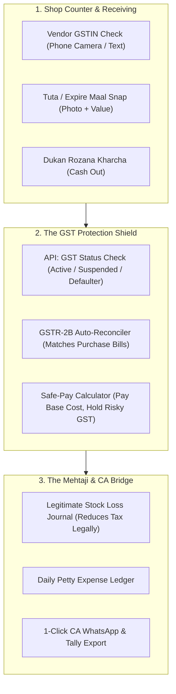

# Retail GST Shield & Mehtaji Operations Suite
## Complete End-to-End Implementation Plan

> **Product Vision**: A zero-jargon, visual financial bodyguard for small-to-mid retail and mall owners. Protects owners from catastrophic GST penalties (like the ₹17 Lakh vendor default notice), tracks legitimate stock losses to legally optimize balance sheets, and bridges the gap between the shop counter, the *Mehtaji*, and the Chartered Accountant (CA).

---

## 1. Executive Context & The Problem Space

### The Real-World Trap (The ₹17 Lakh Fine Scenario)
In traditional retail trade across India (Tier 1, 2, and 3):
1. **The Asymmetry**: Shop owners are financially capable and commercial geniuses at buying and selling, but they rely completely on third-party distributors and local accountants (*Mehtajis*) for compliance.
2. **The GST Hazard**: A supermarket purchases ₹1 Crore of goods and pays ₹18 Lakhs GST to a distributor. The distributor fails to file GSTR-1, cancels their GST, or commits fraud. 
3. **The Penalty**: Under GST Section 16(2)(c), the tax department disallows the ₹18 Lakh Input Tax Credit (ITC) from the **buyer**, issuing recovery notices with 18–24% interest and heavy penalties. The retailer is forced into high court litigation over a mistake made by their supplier.
4. **The Balance Sheet Dilemma**: Small owners struggle to declare their true margins because unaccounted cash expenses, perishable goods spoilage, theft (shrinkage), and broken goods are never systematically documented. They want "adjustments" because they don't know how to book legitimate business losses cleanly.

---

## 2. Target User Persona: The Street-Smart Indian Merchant

```
┌────────────────────────────────────────────────────────────────────────┐
│                        MERCHANT PROFILE                                │
├────────────────────────────────┬───────────────────────────────────────┤
│ • Strong cash flow & capital   │ • Zero appetite for English jargon    │
│ • Deep pricing & buying skills │ • High fear of Tax / GST notices      │
│ • Hands-on at the cash counter │ • Relies on Mehtaji & CA for books    │
└────────────────────────────────┴───────────────────────────────────────┘
```

### Jargon Translation Matrix (Core UX Principle)

| Legal / Enterprise Term | In-App Street-Smart Term | Visual Cue |
| :--- | :--- | :--- |
| **Vendor GSTIN Verification** | **"Party Check (Safe ya Khatra?)"** | 🟢 Green Shield / 🔴 Red Alert |
| **ITC Mismatch (GSTR-2B vs Books)** | **"Bina Bill wala GST (Sarkari portal pe laapata)"** | ⚠️ Warning Banner with ₹ Amount |
| **Payment Retention / Escrow** | **"GST Hold Karke Baaki Payment Do"** | 🔒 Lock Button on Payouts |
| **Inventory Shrinkage Write-off** | **"Tuta-Phoota & Expire Maal ka Hisab"** | 📸 Camera Snap + Quick Amount |
| **Petty Cash Operating Expenses** | **"Dukan ka Rozana Kharcha"** | 💰 One-tap Expense Entry |
| **Statutory Balance Sheet Export** | **"CA / Vakeel ko Bhejne wali File"** | 🟢 1-Click WhatsApp Button |

---

## 3. Product Architecture & Modules



---

## 4. Detailed Feature Specifications

### Module 1: Party GST Shield & Risk Meter
* **User Flow**:
  1. Store clerk or owner types a 15-digit GSTIN or clicks a photo of the supplier's bill header.
  2. The system checks the GST portal status in real-time.
* **Outputs**:
  - **🟢 Safe Party**: Registered, active, returns filed up to date. Message: *"Party Safe Hai. Poora Payment Kar Sakte Hain."*
  - **🟡 Warning Party**: Late filer (GSTR-3B pending for 1–2 months). Message: *"Dhyan dein: Supplier pichle mahine late tha."*
  - **🔴 High-Risk / Cancelled**: GST suspended, cancelled, or 3+ months non-filing. Message: *"KHATRA: Inka GST bandh/suspended hai. Bill mat lo ya GST payment hold karo!"*

### Module 2: The ₹17 Lakh ITC Watchdog (GSTR-2B Matcher)
* **User Flow**:
  1. Once a month (after the 14th), the owner or *Mehtaji* uploads the GSTR-2B Excel/JSON file downloaded from `gst.gov.in` (or connects via GST API).
  2. The system automatically compares store purchase entries with the government's 2B list.
* **The Smart Triage Table**:
  - **Matched**: Bills present in both store records and GSTR-2B $\rightarrow$ Safe to claim ITC.
  - **Missing in 2B**: Bills where the store paid GST to the vendor, but the vendor did NOT upload it $\rightarrow$ Highlighted in bright red with an instant WhatsApp reminder button:
    > *"Namaste Supplier ji, aapka Invoice #402 hamare GST portal pe nahi dikh raha hai. Kripya apna GSTR-1 file karein taaki hum aapka ruka hua payment release kar sakein."*

### Module 3: Safe-Pay Vendor Payment Gate
* **Core Logic**:
  $$\text{Net Immediate Payout} = \text{Base Invoice Amount} + (\text{GST Component if in GSTR-2B})$$
* If an invoice is not in GSTR-2B:
  - System automatically splits the payment voucher into two lines:
    1. Base amount: **Pay Now** (via NEFT/RTGS CSV export).
    2. GST amount: **Held in Safe Escrow** until reflected on the GST portal.
* **Benefit**: Protects the retailer from paying tax twice.

### Module 4: "Tuta-Phoota & Expire Maal" (Stock Loss Logger)
* **Why it matters**: A mall or supermarket easily suffers 1% to 3% stock loss due to carton crush, leaks, rat bite, or FMCG product expiry.
* **User Flow**:
  1. Floor boy or owner opens app on phone, taps **"Nuksan Entry" (Loss Entry)**.
  2. Takes a photo of damaged items.
  3. Enters item name or scans barcode, enters quantity and cost price.
  4. Selects reason: *Damage / Leakage / Expiry / Theft*.
* **Accounting Magic**:
  - Automatically posts a journal entry: `Debit: Loss by Damaged/Expired Stock`, `Credit: Inventory`.
  - When closing stock is valued at year-end, this legitimate loss directly reduces taxable profit on the Balance Sheet **100% legally and with photographic proof for the tax auditor**.

### Module 5: 1-Click "CA & Mehtaji" Export Pack
* A dedicated button: **"Download CA File"** or **"Share to CA on WhatsApp"**.
* Generates a zip bundle containing:
  1. **Audited Purchase Register (Excel)** with GSTR-2B match status.
  2. **Verified ITC Claim Summary** (safe claims vs. deferred claims).
  3. **Stock Loss & Damage Report** with photo references and ledger values.
  4. **Petty Cash & Store Expense Sheet**.
  5. **Tally Prime XML format** so the CA can import all entries directly into Tally in 10 seconds.

---

## 5. Technical Data Models (`@dev-monitor/shared`)

### 1. Vendor Risk Record
```typescript
export interface VendorGSTProfile {
  id: string;
  gstin: string;
  tradeName: string;
  legalName: string;
  status: 'ACTIVE' | 'SUSPENDED' | 'CANCELLED';
  filingFrequency: 'MONTHLY' | 'QRMP';
  lastGstr1FilingDate?: string;
  lastGstr3bFilingDate?: string;
  riskCategory: 'SAFE' | 'WATCHLIST' | 'CRITICAL_RISK';
  totalPurchasesYTD: number;
  unverifiedGstAmount: number; // At-risk GST held
  notes?: string;
}
```

### 2. Purchase Bill with 2B Reconciliation
```typescript
export interface PurchaseInvoice {
  id: string;
  vendorId: string;
  invoiceNumber: string;
  invoiceDate: string;
  baseAmount: number;
  gstAmount: number;
  totalAmount: number;
  gstr2bStatus: 'MATCHED' | 'NOT_REFLECTED' | 'MISMATCHED';
  paymentStatus: 'PAID' | 'PARTIAL_SAFE_PAID' | 'HELD';
  heldGstAmount: number;
}
```

### 3. Stock Loss & Damage Entry
```typescript
export interface StockLossEntry {
  id: string;
  date: string;
  itemBarcode?: string;
  itemName: string;
  category: 'fmcg' | 'produce' | 'packaging' | 'general';
  quantity: number;
  unitCost: number;
  totalLossValue: number;
  reason: 'damage' | 'expiry' | 'leakage' | 'theft_shrinkage';
  photoUrl?: string;
  recordedBy: string;
  approvedForTaxDeduction: boolean;
}
```

---

## 6. Phased Implementation Roadmap

```
┌────────────────────────────────────────────────────────────────────────────┐
│ SPRINT 1: "The Bodyguard" (Vendor Risk & Safe-Pay Calculator)              │
│ • UI: High-contrast Green/Red Vendor Risk Checker                          │
│ • Calculation engine: Base vs. GST component hold logic                    │
│ • Bank Payout CSV integration (hold GST portion from NEFT/RTGS)            │
├────────────────────────────────────────────────────────────────────────────┤
│ SPRINT 2: "The ITC Watchdog" (GSTR-2B Reconciler)                          │
│ • Excel / JSON GSTR-2B file uploader                                       │
│ • Automated match algorithm (Invoice No + GSTIN + Tax Amount)              │
│ • 1-Click WhatsApp payment nudge generator for defaulting suppliers        │
├────────────────────────────────────────────────────────────────────────────┤
│ SPRINT 3: "Legitimate Tax Saver" (Tuta-Phoota & Expense Diary)             │
│ • Mobile-first camera photo logger for damaged/expired goods               │
│ • Daily cash expense logger                                                │
│ • Monthly Legitimate Loss Summary calculation                              │
├────────────────────────────────────────────────────────────────────────────┤
│ SPRINT 4: "The CA Bridge" (Tally & WhatsApp Export)                        │
│ • Single-click WhatsApp PDF generator for CA / Mehtaji                     │
│ • Tally Prime XML purchase & loss voucher export                           │
│ • End-to-end user testing with pilot store owners                          │
└────────────────────────────────────────────────────────────────────────────┘
```

---

## 7. Pilot Strategy & Customer Trust Acquisition

1. **The ₹17 Lakh Wedge Campaign**:
   - Reach out to local retail associations and merchant groups with a clear message:
   - *"Did you know you can get a GST notice even if you paid all taxes, if your supplier didn't file? Check your suppliers for free in 10 seconds."*
2. **On-the-Ground Simplicity**:
   - Set up the app on the owner's desktop or phone.
   - Do the first GSTR-2B check with their existing data to show them: *"Look, Supplier XYZ has not filed ₹45,000 of your tax."*
   - Immediate value realized in under 3 minutes.
3. **CA as a Growth Partner**:
   - CAs hate chasing clients for bills and manual sorting.
   - Give CAs a free partner dashboard to view all their clients' reconciled books.
   - Once a CA likes it, they will bring 50+ shopkeeper clients onto the platform.
