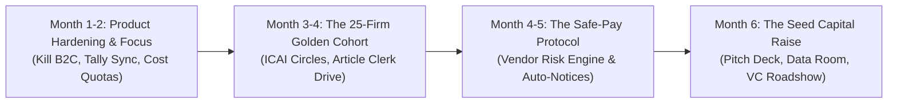

# BillGuru AI — Pre-Funding Execution Plan & Venture Scale Strategy

**Document Version:** 1.0  
**Target Goal:** Execute the 10x pivot, hit institutional Seed round metrics ($500K–$1M raise at $4M–$6M valuation), and build defensible moats to reach venture-scale breakout.  
**Audience:** Founders, Core Engineering & Growth Teams.

---

## Executive Summary: The Pivot from Utility to Clearinghouse

Most Indian accounting and tax startups hit an ARR plateau (₹3 Cr – ₹10 Cr) or die because they position themselves as **"retrospective productivity tools"** (saving CAs data-entry time). CAs in India are notoriously price-sensitive, demand high-touch support, and resist paying premium software subscriptions.

To become a generational fintech/SaaS powerhouse (like Razorpay, FloBiz, or Clear), **BillGuru AI must shift from a passive receipt scanner to an active B2B Payment Risk & ITC Clearinghouse**.

```
+-------------------------------------------------------------------------------------------------+
|                                     THE 10X STRATEGIC PIVOT                                     |
|                                                                                                 |
|   OLD TRAJECTORY: Utility Tool                    NEW TRAJECTORY: Trust & Risk Rail             |
|   ----------------------------                    ---------------------------------             |
|   • "Snap bills to save CA time"                  • "Prevent fake vendor ITC fraud before payout"|
|   • Diluted across B2C Salaried + CAs + SMEs      • 100% focused on B2B Supply Chain compliance |
|   • Retrospective month-end entry                 • Real-time Point-of-Sale Safe-Pay gate       |
|   • Competes on price with Suvit/Vyapar           • Unassailable Network Risk Moat              |
|   • Outcome: ₹5-10 Cr ARR niche lifestyle biz     • Outcome: ₹100 Cr+ ARR Generational Company  |
+-------------------------------------------------------------------------------------------------+
```

---

## 1. Pre-Funding Milestones & VC Traction Gates

To raise a **$750K – $1.5M institutional seed round** from top funds (Blume Ventures, Peak XV Surge, India Quotient, 3one4 Capital, or Accel), you do not need massive revenue, but you **must prove irrefutable product love, unit economics, and network effects**.

### The 4 Non-Negotiable Gates Before Pitching VCs:

| Gate | Metric Required | Why VCs Demand It | Status Check |
| :--- | :--- | :--- | :--- |
| **1. The "Golden Cohort"** | **25 Paid CA Firms** across 2–3 commercial hubs (e.g., Surat, Ahmedabad, Kanpur) | Proves CAs will open their wallets without founder friendship bias. | Target: Month 4 |
| **2. Downstream Scale** | **600+ Active SMEs** forwarding ≥25 bills/month via WhatsApp | Proves shopkeepers actually adopt the zero-UI WhatsApp habit without churn. | Target: Month 5 |
| **3. Financial Value Created** | **> ₹50 Lakhs** in fake/cancelled GSTINs flagged or disallowed ITC saved | Gives you the ultimate pitch metric: *"We saved merchants ₹10 for every ₹1 they paid us."* | Target: Month 5 |
| **4. Unit Economics Viability** | **Gross Margin > 72%** (Net of WhatsApp API & LLM vision costs) | Proves the business doesn't bleed cash as bill volume surges. | Target: Month 3 |

---

## 2. Phase-by-Phase Implementation Roadmap (6-Month Sprint)



---

### Phase 0: Radical Focus & Engine Hardening (Months 1 – 2)

#### Step 1: Deprioritize Consumer B2C (The Distraction Cut)
* **Action:** Freeze development on the Salaried Tax Locker, Form 16 parser, and ITR-1 self-filing flows.
* **Rationale:** Consumer tax is hyper-seasonal (July spike, then 11 months of dormancy) and has high churn with sub-₹300 ARPU. Every developer hour spent on HRA rent slips delays your B2B supply-chain moat.

#### Step 2: Fix the Unit Economics Flaw (Hard Quotas & Fair Use)
* **The Problem:** Unlimited bill ingestion at ₹999 or ₹2,499 destroys gross margins when a single wholesale client uploads 1,500 bills a month.
* **Implementation:**
  * **Starter Plan (₹1,499/mo):** Up to 25 clients, 500 processed bills included. Additional bills: ₹1.50/bill.
  * **Pro Plan (₹3,499/mo):** Up to 75 clients, 2,000 processed bills included. Additional bills: ₹1.20/bill.
  * **WhatsApp API Cost Optimization:** Aggregate responses into a single 24-hour service conversation window. Do not ping the user for every status change; batch daily audit summaries at 8:00 PM.
  * **Vision Token Caching:** Cache extracted merchant headers (GSTIN, Address, Bank details) in Redis/MySQL. If an invoice is from a known supplier, only parse line items and tax totals, cutting multimodal token usage by 60%.

#### Step 3: Dual-Pass Zero-Hallucination Pipeline
```
[WhatsApp Bill Image] 
         │
         ▼
[Vision LLM Extraction] ──> Extracts (Taxable Value, CGST, SGST, IGST, Total)
         │
         ▼
[Deterministic Math Check] ──> Does (Taxable * Slab == Tax)? Does (Taxable + Tax == Total)?
         │
    ┌────┴──────────────────────────┐
    ▼                               ▼
[MATCH (± ₹1 round-off)]      [MISMATCH / BLUR]
Auto-verified                  Flagged for CA Triage Queue (Confidence < 0.9)
Instant GSTIN Status Check     WhatsApp Alert: "Please verify total amount"
```

#### Step 4: Build the "TallyPrime Desktop Connector"
* Build an ultra-lightweight Windows system tray utility (Electron or Go).
* Connects via localhost XML / ODBC to open Tally instances on the CA firm's desktop.
* 1-Click push: Turns verified WhatsApp invoices directly into Purchase Vouchers (`F9`) in Tally without manual CSV mapping.

---

### Phase 1: The "Golden Cohort" Acquisition Playbook (Months 3 – 4)

**Target:** Onboard 25 paying CA firms and 600 active downstream SME counters.

```
THE DISTRIBUTION FUNNEL:
1. Identify 50 Target CA Firms in 2 Trading Clusters (e.g., Surat Textile Market & Kanpur Leather/Hardware)
       │
       ▼
2. Pitch the "Article Clerk Rescue Plan" (Free 14-day trial during GSTR-3B week)
       │
       ▼
3. Onboard CA's 5 messiest clients on WhatsApp (Zero client app install)
       │
       ▼
4. Deliver the "Caught Error Report" on the 18th of the month
       │
       ▼
5. Convert CA to Paid Annual / Semi-Annual Subscription
```

#### Tactics for Hand-to-Hand CA Acquisition:
1. **The Article Clerk Champion Strategy:** Senior CA partners don't type bills; 22-year-old article trainees and junior accountants (*Mehtajis*) do. Target them via LinkedIn and local WhatsApp groups. Give them a tool that lets them leave the office at 6:00 PM instead of 11:00 PM on filing deadlines.
2. **The "DRC-01 Audit Shield" Demonstration:** In your sales demo, take 10 of their client's historical purchase bills. Run them through BillGuru. If even *one* vendor has a cancelled GSTIN or mismatched rate, show the CA the exact tax notice they just avoided.
3. **The Co-Branded WhatsApp Ingestion Node:** Configure the WhatsApp bot so that when the merchant submits an invoice, the bot displays the CA Firm's name:
   > *"🟢 Invoice Verified for Sharma Electricals. Taxable: ₹12,000 | GST: ₹2,160. Synced to your file at **M/s Singhania & Co., Chartered Accountants**."*

---

### Phase 2: Deploy The Breakthrough Wedge — "Safe-Pay" (Months 4 – 5)

This is the feature that elevates BillGuru from a CA utility to a multi-billion dollar platform.

```
                     THE SAFE-PAY WORKFLOW ENGINE
                     
   [Shopkeeper snaps Vendor Bill on WhatsApp at delivery counter]
                                 │
                                 ▼
                     [BillGuru Instant Risk Scan]
                                 │
            ┌────────────────────┴────────────────────┐
            ▼                                         ▼
   [Vendor GST Active & Clean]             [Vendor GST Delayed / Suspended]
   Status: 🟢 SAFE PARTY                  Status: 🔴 HIGH RISK (ITC at Danger)
   "Pay full invoice amount."              "Do NOT pay full amount."
                                                      │
                                                      ▼
                                       [Split-Payment Advice Generated]
                                       • Base Amount (₹40,000): Pay Now
                                       • GST Portion (₹7,200): HOLD
                                                      │
                                                      ▼
                                   [Automated WhatsApp Message to Vendor]
                                   "Namaste Supplier Ji, Invoice #102 base
                                    payment initiated. GST amount held in
                                    Safe-Pay until uploaded to GST portal."
```

#### Why This Creates an Unbeatable Moat:
1. **Network Effects:** When 500 merchants use BillGuru, your system maps thousands of vendors. You know which suppliers in Surat or Delhi default on their taxes weeks before the GST department issues a formal notice.
2. **Vendor Viral Loop:** Suppliers who have their GST payments held will ask: *"How do I get marked as a Verified Supplier on BillGuru so my buyers pay me 100% upfront?"* The vendors themselves begin signing up.

---

### Phase 3: The Seed Fundraising Campaign (Month 6)

#### 1. Target Investor Shortlist (India Seed / Fintech)
* **Tier-1 Funds:** Peak XV (Surge), Accel Atoms, Elevation Capital (Seed).
* **Fintech/SaaS Specialist Seed Funds:** Blume Ventures, India Quotient, 3one4 Capital, Better Capital, Titan Capital.
* **Strategic Angels:** Founders of Razorpay, Khatabook, Clear, FloBiz, and prominent ICAI council leaders.

#### 2. The Winning Pitch Narrative (The 10-Slide Deck Architecture)

```
SLIDE 1: The Huge Injustice
"In India, if your supplier doesn't pay their taxes, the Government raids YOUR bank account."
(Cite Section 16(2)(c) of CGST Act & the ₹17 Lakh penalty trap).

SLIDE 2: The Status Quo Fails
"Tally is desktop-bound. Suvit is retrospective month-end. Shopkeepers live on WhatsApp."

SLIDE 3: The Solution (BillGuru AI)
"The WhatsApp-native point-of-sale risk shield and zero-entry accounting bridge."

SLIDE 4: Traction & The Magic Number
- 25 Paying CA Firms (Zero churn over 90 days)
- 750 Active SME retail nodes
- ₹1.8 Crore in verified B2B GMV processed monthly
- ₹12 Lakhs in disallowed ITC prevented for clients

SLIDE 5: The Secret Weapon (Safe-Pay & Vendor Risk Graph)
"Every bill scanned makes our nationwide supplier default prediction engine smarter."

SLIDE 6: Unit Economics
"LTV/CAC > 10x. 78% Gross Margin. Software-only distribution via existing CA client books."

SLIDE 7: Market Size (TAM/SAM)
"1.45 Crore GST entities + 3.5 Lakh CAs = $2.1B initial domestic compliance and risk market."

SLIDE 8: The Vision (The B2B Trust Clearinghouse)
"From bill verification to B2B payment escrow, invoice discounting, and statutory tax clearance."

SLIDE 9: Team
"Technical execution, deep tax domain insight, and boots-on-the-ground CA distribution."

SLIDE 10: The Ask
"$750,000 for 18 months of runway to expand to 500 CA firms, 25,000 SMEs, and ₹5 Cr ARR."
```

---

## 3. Product Backlog & Engineering Priority Matrix

| Sprint | Module | Exact Deliverables | Target KPI |
| :---: | :--- | :--- | :--- |
| **Sprint 1** (Weeks 1-2) | **Cost & Quota Architecture** | - Implement invoice quota counters per CA workspace in MySQL.<br>- Build Redis cache for recurrent vendor GSTIN metadata.<br>- Set up 24-hr WhatsApp message batching. | Reduce marginal cost per invoice below ₹1.00. |
| **Sprint 2** (Weeks 3-4) | **Zero-Hallucination OCR** | - Add dual-pass regex math cross-checker.<br>- Build high-speed Inward Triage Queue for low-confidence (<0.9) parses.<br>- Support WhatsApp quick-reply buttons ("Approve", "Edit Amount"). | 95%+ extraction accuracy without human intervention. |
| **Sprint 3** (Weeks 5-6) | **Tally Local Bridge** | - Lightweight background agent that parses BillGuru verified bills and exports Tally-compliant XML.<br>- Test with TallyPrime 3.0 / 4.0. | Zero manual CSV data-formatting for CAs. |
| **Sprint 4** (Weeks 7-8) | **Safe-Pay & Party Shield** | - Instant GSTIN Active/Suspended status query via GSP API.<br>- Generate split payment advice slip (Pay Base / Hold Tax).<br>- Automated WhatsApp supplier notification templates. | 1st live vendor payment retention executed by a merchant. |
| **Sprint 5** (Weeks 9-10) | **Analytics & Audit Reports** | - "ITC Savings Bento Grid" showing real money protected.<br>- 1-click WhatsApp audit report generator for CAs to send clients on the 15th. | 40%+ weekly engagement by CA firm partners. |

---

## 4. Financial Runway & Bootstrapping Budget (Months 1–6)

To execute this plan prior to institutional funding, you need approximately **₹18 Lakhs to ₹25 Lakhs ($22K – $30K)** in lean capital:

```
+-------------------------------------------------------------------------+
|                  6-MONTH PRE-FUNDING BUDGET ALLOCATION                  |
|                                                                         |
| [Engineering & Core Team]          ₹12,00,000 (Lean founder stipends)   |
| [WhatsApp Business API & LLMs]     ₹2,50,000  (Meta fees + Vision APIs) |
| [GSP / Sandbox GST API Access]     ₹1,50,000  (Government data rails)   |
| [On-Ground CA Pilot Onboarding]    ₹2,00,000  (Travel, demos, collaterals)|
| [Cloud Infrastructure & Security]  ₹1,50,000  (Render, AWS, DB backups) |
| [Buffer / Contingency]             ₹1,50,000                            |
| ----------------------------------------------------------------------- |
| TOTAL ESTIMATED BUDGET:            ₹21,00,000 (~$25,000 USD)            |
+-------------------------------------------------------------------------+
```

---

## 5. Summary Checklist: "Are We Ready to Pitch VCs?"

Do not book formal partner pitch meetings until at least **8 of these 10 boxes** are checked:

- [ ] **1.** Salaried B2C tax features are completely decoupled/deprioritized from the core sales pitch.
- [ ] **2.** At least 20 Chartered Accountants are paying via monthly recurring invoice or annual upfront contract.
- [ ] **3.** More than 500 SME shop owners/businesses are actively uploading bills via WhatsApp every week.
- [ ] **4.** The platform has processed at least 25,000 live invoices through the multimodal pipeline.
- [ ] **5.** Software gross margin is mathematically proven to be >70% under current pricing and token costs.
- [ ] **6.** Tally integration is fully functional: 1-click import into TallyPrime tested and certified with 5 CA firms.
- [ ] **7.** At least 3 recorded video testimonials from CAs stating: *"BillGuru saved my firm 50+ hours this filing cycle."*
- [ ] **8.** Safe-Pay vendor risk check is active: showing documented instances of fake/cancelled GSTINs caught before payment.
- [ ] **9.** Cohort chart shows month-on-month client retention above 90% across the first 60 days.
- [ ] **10.** Clean, investor-ready Data Room prepared with 5-year financial model, cap table, and customer reference sheet.
