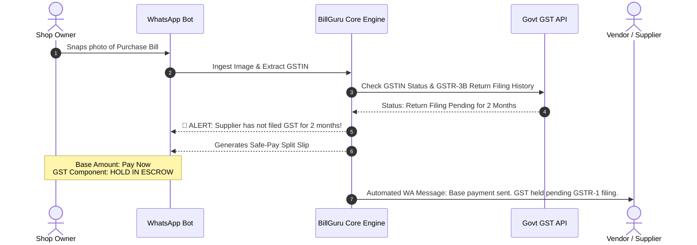

# BillGuru AI — Product Improvement & Strategic Change Masterplan

**Document Version:** 1.0  
**Context:** Actionable change requirements derived from the Tier-1 VC Evaluation and Gap Analysis.  
**Objective:** Detail exactly what to **Stop**, **Change**, **Build**, and **Optimize** across Product Architecture, Pricing, Positioning, and GTM before seeking external funding.

---

## 1. Summary of Strategic Shifts (Stop vs. Start)

```
+--------------------------------------------------------------------------------------------------+
| CATEGORY          | ❌ CURRENT / STOP DOING                    | ✅ REQUIRED CHANGE / START DOING  |
+-------------------+------------------------------------------+-----------------------------------+
| Scope & Audience  | Diluting across B2C Salaried + CAs + SMEs| 100% Focus on B2B Supply Chain    |
| Core Positioning  | "AI Tax Copilot & Bill Scanner"          | "Point-of-Sale GST Fraud Shield"  |
| Monetization      | Flat unlimited bills (Margin killer)     | Tiered base quotas + Overage fees |
| Technology        | Single-pass LLM OCR (Hallucination risk) | Dual-pass Deterministic Math Gate |
| Accounting Bridge | Manual CSV / JSON downloads              | Background Tally XML Desktop Sync |
| Sales Wedge       | "Save 15 mins on typing for CAs"         | "Save ₹50,000 in lost ITC fraud"  |
+--------------------------------------------------------------------------------------------------+
```

---

## 2. Product & Architecture Changes (Engineering Requirements)

### 2.1 Deprecate & Decouple B2C Salaried Tax Modules
* **The Issue:** `schema.sql` and `server.js` currently contain routes and tables for `personal_tax_profiles`, `tax_deductions`, `form16_records`, and Old vs. New Regime comparisons. This divides engineering focus and confuses B2B buyers.
* **Required Action:**
  * **Frontend:** Remove or tuck away the "Salaried Tax Locker" and "Personal ITR" tabs from the main navigation. Set them behind a feature flag (`ENABLE_CONSUMER_TAX=false`).
  * **Marketing/Docs:** Strip all consumer ITR messaging from the landing page, pitch deck, and sales one-pagers.
  * **Keep in DB (Dormant):** Leave schema tables intact, but redirect 100% of sprint bandwidth to B2B purchase ledger accuracy and vendor validation.

---

### 2.2 Fix Unit Economics: Implement Quota Tracking & Rate Limiting
* **The Issue:** Meta WhatsApp Business API charges per 24-hour conversation window (~₹0.35–₹0.80), and multimodal vision APIs (Gemini Flash / GPT-4o-mini) charge per page. At flat pricing (₹999/mo for 25 clients), a high-volume client uploading 2,000 bills per month generates negative gross margin.
* **Database Schema Changes Required (`schema.sql`):**
  ```sql
  -- Add usage quota and overage tracking to accountants
  ALTER TABLE accountants 
  ADD COLUMN monthly_invoice_quota INT DEFAULT 500,
  ADD COLUMN invoices_processed_this_month INT DEFAULT 0,
  ADD COLUMN overage_rate_per_invoice DECIMAL(4,2) DEFAULT 1.50,
  ADD COLUMN quota_reset_date DATE NULL;

  -- Add monthly tracking per business
  ALTER TABLE businesses
  ADD COLUMN monthly_invoices_count INT DEFAULT 0;
  ```
* **Backend Middleware (`backend/server.js`):**
  * Introduce an invoice pre-check middleware before triggering the LLM vision pipeline:
  * If `invoices_processed_this_month >= monthly_invoice_quota`, automatically track bill as overage and bill dynamically, or trigger an upgrade modal.

---

### 2.3 Optimize Vision LLM & WhatsApp Messaging COGS
* **Prompt & Image Compression:**
  * Downscale smartphone camera photos (frequently 4MB–8MB) to 1280px width (JPEG 80% quality) on the backend before sending to Gemini Flash/GPT-4o. Reduces token payload and processing latency by 70%.
* **Vendor Master Data Caching:**
  * In `gstin_validations`, cache supplier metadata (legal name, active status, filing compliance) for 7 days.
  * When a repeat invoice arrives with an existing verified GSTIN, bypass the government GST API lookup and only parse transaction lines.
* **WhatsApp Session Aggregation:**
  * Do not send individual WhatsApp replies for every single bill. If a merchant sends 10 photos in a row, batch them into a single summary notification 60 seconds after the last photo:
    > *"Received 8 bills: 7 Verified 🟢, 1 Needs Review ⚠️. Total Taxable: ₹64,200 | Total GST: ₹11,556. Synced to your CA."*

---

### 2.4 The Dual-Pass Math Verification Gate (Zero-Hallucination)
* **The Problem:** Vision LLMs occasionally hallucinate digits on blurred or folded paper bills (e.g., mistaking `₹18,000` for `₹13,000`), which causes statutory filing errors.
* **Required Implementation:**
  * **Pass 1:** Model extracts `taxable_amount`, `tax_rate`, `cgst_amount`, `sgst_amount`, `igst_amount`, and `total_amount`.
  * **Pass 2 (Deterministic Code Check):**
    $$\text{Expected Tax} = \text{taxable\_amount} \times \left(\frac{\text{tax\_rate}}{100}\right)$$
    $$\text{Calculated Total} = \text{taxable\_amount} + \text{cgst} + \text{sgst} + \text{igst}$$
  * If $|\text{Calculated Total} - \text{Extracted Total}| > ₹1.00$:
    * Mark invoice status as `needs_review` (`extraction_confidence < 0.85`).
    * Push to CA's **Inward Triage Queue** with mismatch badge.
    * Do **not** sync unverified math to the accounting ledger.

---

### 2.5 Build the "TallyPrime XML / ODBC Desktop Connector"
* **The Problem:** CAs refuse to export CSVs, re-format columns, and manually import them into Tally. If it takes more than 2 clicks, they stop using the product.
* **Required Implementation:**
  * Create a lightweight Node/Electron or Go background worker (`BillGuruTallyBridge.exe`) for Windows.
  * Listen for approved invoices from the BillGuru API and post XML requests directly to Tally's local server port (Default: `http://localhost:9000`).
  * Creates native **Purchase Vouchers (`F9`)** with correct ledger mapping (`Sundry Creditors` $\rightarrow$ Vendor Name, `Input CGST/SGST` $\rightarrow$ Tax Ledgers).

---

## 3. The 10x Innovation: The "Safe-Pay" Module

To become a market-leading product rather than an OCR utility, build the **Safe-Pay Risk Engine**:



### Database Schema Addition (`schema.sql`):
```sql
CREATE TABLE IF NOT EXISTS safe_pay_vouchers (
  id INT PRIMARY KEY AUTO_INCREMENT,
  invoice_id INT NOT NULL,
  business_id INT NOT NULL,
  vendor_gstin VARCHAR(15) NOT NULL,
  base_amount DECIMAL(12,2) NOT NULL,
  held_tax_amount DECIMAL(12,2) NOT NULL,
  status ENUM('active_hold', 'released_in_2b', 'disputed', 'manual_release') DEFAULT 'active_hold',
  vendor_whatsapp VARCHAR(15) NULL,
  vendor_notified_at TIMESTAMP NULL,
  released_at TIMESTAMP NULL,
  created_at TIMESTAMP DEFAULT CURRENT_TIMESTAMP,
  FOREIGN KEY (invoice_id) REFERENCES invoices(id) ON DELETE CASCADE,
  FOREIGN KEY (business_id) REFERENCES businesses(id) ON DELETE CASCADE
);
```

---

## 4. Pricing & Packaging Restructuring

Replace the current pricing model with a sustainable, margin-protected structure:

| Tier | Price | Quota & Features | Margin Target |
| :--- | :--- | :--- | :---: |
| **CA Starter** | **₹1,499 / month** | Up to 25 SME clients, 500 bills/mo.<br>₹1.50 per excess bill. Includes Tally XML export. | **76%** |
| **CA Growth** | **₹3,499 / month** | Up to 100 SME clients, 2,000 bills/mo.<br>₹1.20 per excess bill. Direct TallyBridge sync + Inward Triage. | **82%** |
| **CA Enterprise** | **₹7,999 / month** | Up to 300 clients, 6,000 bills/mo.<br>Multi-branch CA login, custom WhatsApp sender name. | **85%** |
| **Direct SME (Shop)**| **₹349 / month** | 1 Business, 100 bills/mo.<br>Live Vendor GSTIN Shield + Safe-Pay Split Vouchers. | **74%** |

---

## 5. UI & Messaging Changes

### 5.1 Landing Page & Pitch Narrative Updates
* **Header Headline:**  
  * *Old:* "AI-Powered GST & Personal Tax Copilot for Businesses, Salaried, and CAs"  
  * *New:* **"The WhatsApp GST Shield That Stops Fake Vendor Fraud and Protects Your Input Tax Credit."**
* **Metrics Bento Grid:**  
  * Replace "Total Bills Processed" with **"Total Tax Money Protected (₹)"** and **"High-Risk Vendors Flagged"**.
* **Street-Smart Microcopy (Hindi/English Hybrid for Merchants):**
  * `Safe Party (Poora Payment Kar Sakte Hain)` 🟢
  * `Warning Party (Supplier pichle mahine late tha)` 🟡
  * `Khatra / Inactive GSTIN (GST Payment Hold Rakhein)` 🔴

---

## 6. Execution Roadmap & Priority Checklist

```
+-----------------------------------------------------------------------------------------+
| SPRINT 1 (Weeks 1-2): Core Cost & Margin Fixes                                          |
| [ ] Add quota columns to accountants & businesses in MySQL.                             |
| [ ] Add image compression middleware before LLM vision calls.                           |
| [ ] Implement 7-day vendor master cache in Redis/MySQL.                                 |
+-----------------------------------------------------------------------------------------+
| SPRINT 2 (Weeks 3-4): Quality & Accuracy Upgrades                                       |
| [ ] Implement deterministic math verification formula.                                  |
| [ ] Build batching window (60s delay) for multiple WhatsApp image uploads.              |
| [ ] Set up confidence-gated Inward Triage Queue for low-scoring invoices.               |
+-----------------------------------------------------------------------------------------+
| SPRINT 3 (Weeks 5-6): Accounting Integration                                            |
| [ ] Develop Tally XML export endpoint (/api/export/tally-xml).                          |
| [ ] Package lightweight local Windows connector for TallyPrime.                         |
| [ ] Pilot with 3 CA partner firms on real filing data.                                  |
+-----------------------------------------------------------------------------------------+
| SPRINT 4 (Weeks 7-8): The Safe-Pay Protocol                                             |
| [ ] Build safe_pay_vouchers table & business logic.                                     |
| [ ] Add WhatsApp split-payment card output for shopkeepers.                             |
| [ ] Implement automated vendor WhatsApp notification template.                          |
+-----------------------------------------------------------------------------------------+
| SPRINT 5 (Weeks 9-10): Institutional VC Data Room & Pitch Prep                          |
| [ ] Onboard 20 paying CA firms in 2 trading hubs (Surat/Kanpur).                        |
| [ ] Record 3 CA video testimonials highlighting hours & tax saved.                      |
| [ ] Assemble Data Room (Unit economics, Cap table, Cohort retention).                   |
+-----------------------------------------------------------------------------------------+
```
